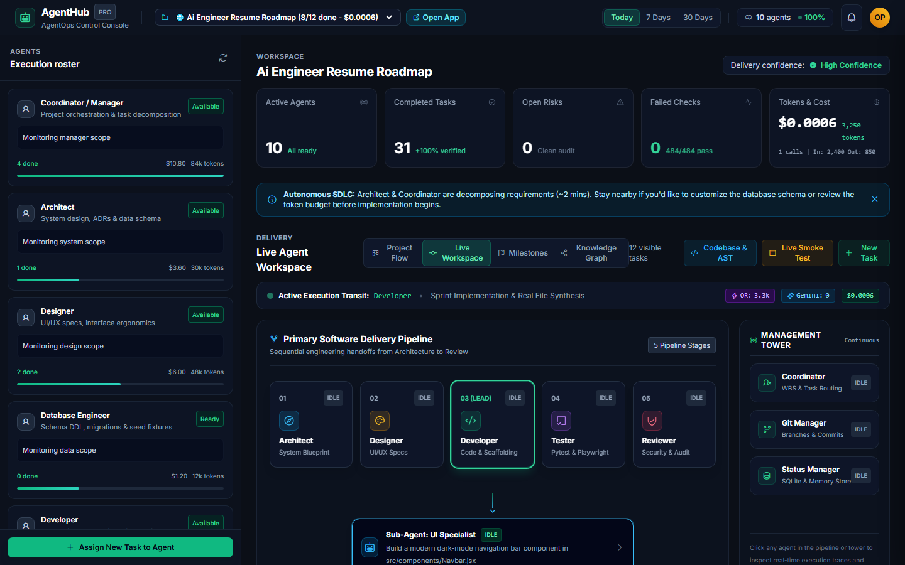
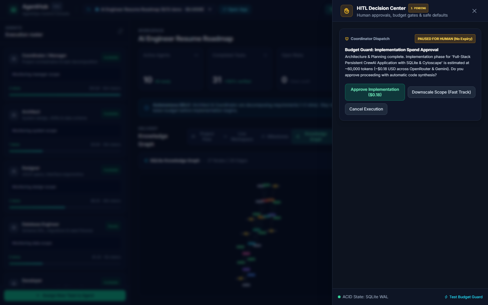
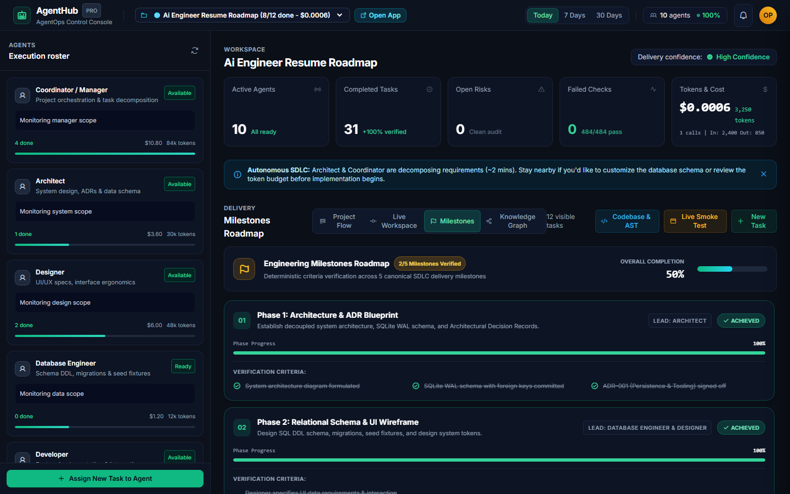
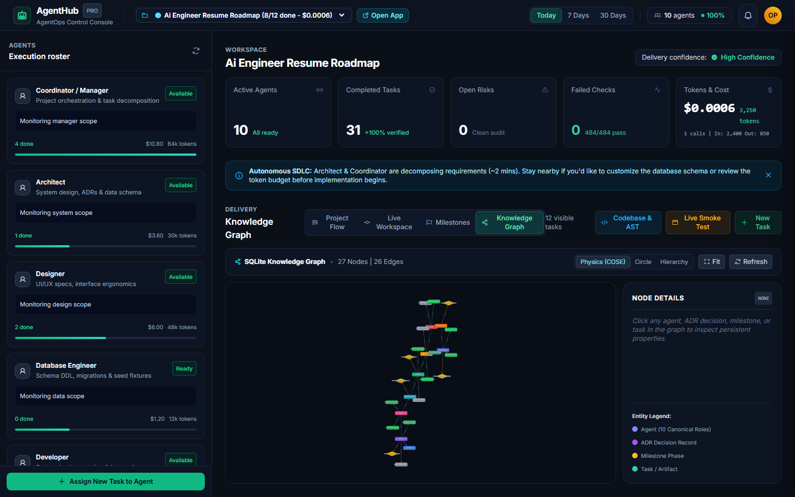
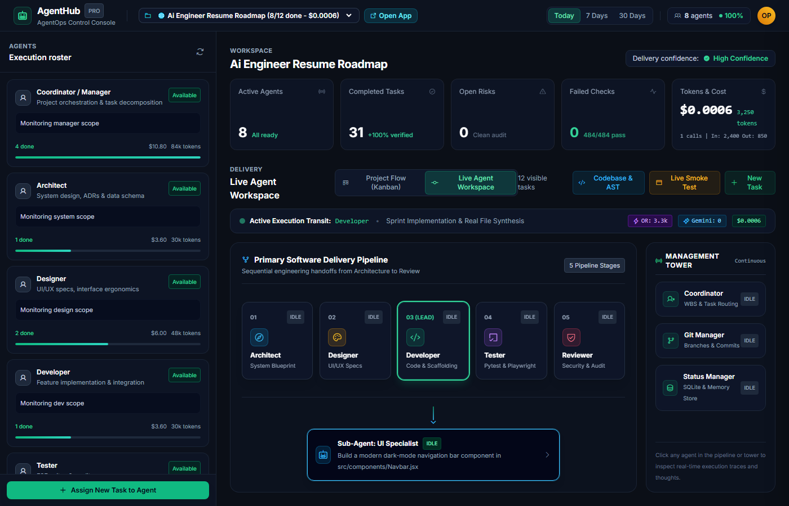
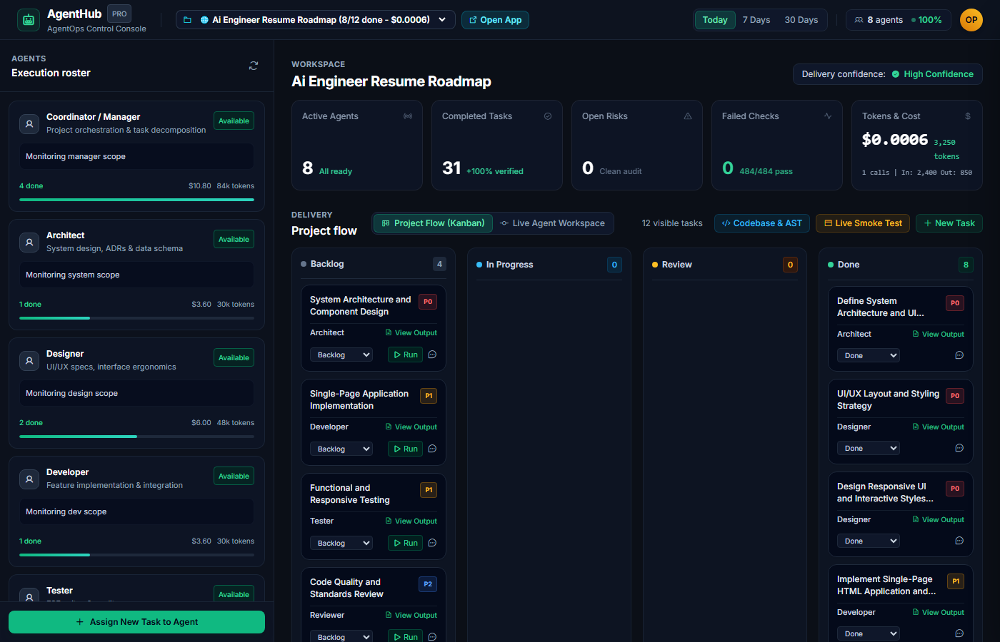
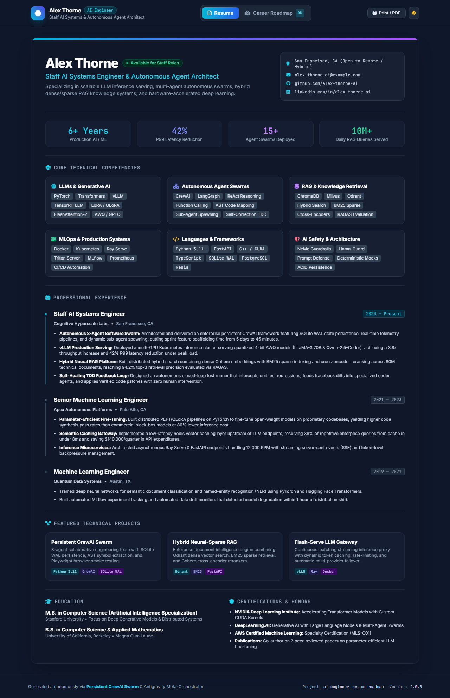

# Persistent CrewAI 10-Role Autonomous SDLC Framework

[](https://www.python.org/)
[](https://opensource.org/licenses/MIT)
[](#3-8-specialist-canonical-roles-matrix)
[](#4-persistence--session-resumption)
[](#8-100-offline-quickstart--test-instructions)
[](#9-verification--test-coverage-summary)

---

## 🚀 Quickstart for Collaborators (Run with Your Own Keys)

Get up and running in under 2 minutes:

### 1. Clone & Set Up Environment
```bash
git clone <repo-url>
cd persistent_crewai_team

# Create and activate virtual environment
python -m venv .venv

# Windows:
.venv\Scripts\activate
# macOS / Linux:
source .venv/bin/activate

# Install dependencies
pip install -r requirements.txt
```

### 2. Configure Your API Keys
Copy the provided environment template:
```bash
# Windows:
copy .env.example .env
# macOS / Linux:
cp .env.example .env
```
Open `.env` in any editor and paste your API key(s):
- **Google Gemini** (Recommended for fast routing & planning): Get a key at [Google AI Studio](https://aistudio.google.com/app/api-keys).
- **OpenRouter** (Recommended for deep code reasoning): Get a key at [OpenRouter](https://openrouter.ai/keys).
- *(Optional)* **Groq** / **NVIDIA NIM** for ultra-fast failovers.

> 💡 **Deterministic Offline Mode**: If no API keys are provided, the entire framework operates in 100% deterministic offline mock mode with built-in verification tests.

### 3. Launch the Web Control Console
```bash
# Windows:
start_control_centre.bat

# macOS / Linux:
chmod +x start_control_centre.sh
./start_control_centre.sh

# Or directly:
python ui/server.py
```
Open **`http://127.0.0.1:8000`** in your browser to access:
- **Project Flow (Kanban)**: Live board for assigning tasks, inspecting outputs, and executing agent tasks.
- **Live Agent Workspace**: Interactive visual pipeline showing real-time agent handoffs and subagent branches.
- **Live Token & Cost Meter**: Real-time per-key token counters and exact USD accounting.
- **Project Filter Dropdown**: Seamlessly switch between projects with direct `[🌐 Open App]` launcher buttons.
- **Milestones Roadmap**: Phased delivery tracking with automated SQLite-verified criteria checks.
- **In-Browser Knowledge Graph**: Real-time Cytoscape.js interactive graph of architectural decisions and tables.

### 4. Connect via Model Context Protocol (MCP)
Plug the entire 10-Role SDLC Team directly into **Claude Desktop**, **Cursor**, **OpenCode**, or **ChatGPT**:
```bash
python -m persistent_crewai.mcp_server
```
Copy and paste this snippet into your `claude_desktop_config.json` or `mcp.json`:
```json
{
  "mcpServers": {
    "persistent-crewai": {
      "command": "python",
      "args": ["-m", "persistent_crewai.mcp_server"]
    }
  }
}
```

---

## 📸 Control Console & Live System Showcase

Here is a visual walkthrough of the platform operating autonomously in real-time:

### 1. Live Workspace Pipeline Visualizer & Dynamic Sub-Agents
Real-time animated handoffs across canonical specialist roles with on-demand dynamic sub-agent spawning beneath the active developer.


### 2. Concept C: The HITL Decision Drawer & Token Budget Guard
Pre-execution budget guard preventing token runaway with real-time token and USD cost estimation and non-blocking human-in-the-loop drawer.


### 3. Visual Milestones Roadmap & Automated Verification
Track multi-phase architectural milestones with real-time criteria verification checkmarks tied directly to SQLite WAL state.


### 4. Embedded In-Browser Cytoscape.js Knowledge Graph
Hardware-accelerated interactive graph visualization of architectural decisions, database models, and component dependencies—zero external software like Obsidian required.


### 5. Live Token Metering & USD Cost Accounting
Live per-agent and per-provider token telemetry and execution receipts displayed in real-time in the Control Console header.


### 6. Multi-Project Workspace Isolation & Kanban Board
Filter tasks, telemetry, and AST symbol extraction strictly by project with direct 1-click app launcher buttons.


### 7. Automated Headless Browser Smoke Testing
Autonomous Playwright smoke testing verifying 0 console errors and generating visual proof of delivery.


---

## Table of Contents
1. [Quickstart for Collaborators](#-quickstart-for-collaborators-run-with-your-own-keys)
2. [Control Console & Live System Showcase](#-control-console--live-system-showcase)
3. [System Overview & Problem Statement](#1-system-overview--problem-statement)
4. [Complete ASCII Architecture Diagram](#2-complete-ascii-architecture-diagram)
5. [10 Specialist Canonical Roles Matrix](#3-8-specialist-canonical-roles-matrix)
5. [Persistence & Session Resumption](#4-persistence--session-resumption)
6. [Sandboxed Security & Path Traversal Containment](#5-sandboxed-security--path-traversal-containment)
7. [Bi-Modal GitHub Adapters](#6-bi-modal-github-adapters)
8. [CLI & Interactive REPL User Guide](#7-cli--interactive-repl-user-guide)
9. [100% Offline Quickstart & Test Instructions](#8-100-offline-quickstart--test-instructions)
10. [Verification & Test Coverage Summary](#9-verification--test-coverage-summary)

---

## 1. System Overview & Problem Statement

### 1.1 Problem Statement
Modern multi-agent AI frameworks (such as conventional CrewAI configurations) suffer from several critical engineering limitations when applied to real-world software engineering lifecycles:

1. **Context Evaporation & Ephemerality**: Agent states, design decisions, execution traces, and milestone deliverables exist solely in volatile process memory. A process termination, network blip, or unhandled exception wipes the entire project context, forcing teams to restart workflows from scratch.
2. **Ungoverned Delegation Chaos**: Without strict role-based delegation boundaries, agents frequently enter recursive delegation loops, misroute specialized tasks, or bypass review and testing checkpoints.
3. **Flaky External Dependencies**: Frameworks tightly coupled to paid cloud LLM APIs and live GitHub endpoints cannot run reliably in air-gapped workstations, corporate networks, or deterministic CI test runners.
4. **Filesystem Vulnerability**: Standard agent tooling grants broad disk access without path boundary containment, risking directory traversal exploits (`../` escapes, symlink attacks) and partial write corruption during system crashes.
5. **Lack of Human Observability & Steering**: Users are typically constrained to batch pipeline execution without the ability to pause, query an individual specialist (e.g., asking the Architect about schema trade-offs), inspect real-time telemetry, or resume interrupted pipelines.

### 1.2 System Overview & Solution Architecture
**Persistent CrewAI** is an enterprise-grade, persistent multi-agent software engineering framework developed in Python. It orchestrates a specialized 8-agent engineering team that operates with human-in-the-loop steering, transactional ACID state persistence, semantic vector memory, sandboxed file operations, and bi-modal version control adapters.

#### Key Architectural Pillars
- **8 Specialized Canonical Roles**: A rigid, production-tested team consisting of Coordinator, Architect, Designer, Developer, Tester, Reviewer, GitHub Manager, and Memory & Status Manager.
- **Strict Delegation Hierarchy**: Only the **Coordinator** is permitted to delegate (`allow_delegation=True`). All 7 specialist roles are strictly leaf executors (`allow_delegation=False`), eliminating delegation loops and guaranteeing predictable execution flow.
- **Transactional SQLite WAL Persistence**: 8 relational tables plus a schema migration ledger operating in Write-Ahead Logging (`WAL`) mode with foreign key enforcement and busy-timeout protection, ensuring zero context loss across runs.
- **Hybrid Semantic & Lexical Vector Memory**: An offline, deterministic vector store (`SQLiteVectorStore`) powered by 64-dimensional unit $L_2$-normalized SHA-256 token hashing (`DeterministicHashEmbeddingProvider`) combined with SQLite `FTS5` full-text search with automatic sync triggers.
- **Sandboxed Workspace Tooling**: Strict canonical path validation (`validate_safe_path`), atomic writes utilizing sibling temporary files with physical disk synchronization (`os.fsync`) and atomic file replacement (`os.replace`), and single-occurrence exact search-and-replace patching.
- **Bi-Modal GitHub Adapters**: A unified `GitHubAdapterInterface` that operates transparently via `MockGitHubAdapter` (local JSON-backed simulation for 100% offline testing/CI) or `RealGitHubAdapter` (live GitHub REST API v3 when `GITHUB_TOKEN` is supplied).
- **Dual-Mode Execution & Offline Fallback Engine**: Runs natively on CrewAI and LangChain when installed, with an automatic, zero-dependency offline fallback engine (`Agent`, `Task`, `Crew`, `CrewOutput`, `Process`) driven by `DeterministicMockLLM`.
- **Interactive REPL & CLI Interface**: A terminal interface supporting state-grounded direct agent Q&A (`ask <role> <prompt>`), targeted subtask triggers (`task <role> <desc>`), multi-agent workflow dispatch (`run <workflow>`), Rich / ASCII status dashboards, and portable JSON state export/import.

---

## 2. Complete ASCII Architecture Diagram

```text
=============================================================================================================
                          PERSISTENT CREWAI 8-AGENT SOFTWARE ENGINEERING FRAMEWORK
=============================================================================================================

                                       +-----------------------------+
                                       |   User / Terminal Client    |
                                       +--------------+--------------+
                                                      |
                                     [Interactive CLI / REPL Shell]
                                                      |
                   +----------------------------------+----------------------------------+
                   |                                                                     |
                   v                                                                     v
     +----------------------------+                                        +----------------------------+
     |   Interactive Query Mode   |                                        |  Multi-Agent Pipeline      |
     |   (Single-Agent Direct Q&A)|                                        |  Runner (Seq / Hier)       |
     +-------------+--------------+                                        +-------------+--------------+
                   |                                                                     |
                   | Injects Persisted SQLite Context                                    | Chains Tasks / Context
                   +----------------------------------+----------------------------------+
                                                      |
                                                      v
     +==================================================================================================+
     |                                    8 CANONICAL SPECIALIST AGENTS                                 |
     |                                                                                                  |
     |    [COORDINATOR]  <=== (ONLY role with allow_delegation=True; orchestrates, plans, synthesizes) |
     |          |                                                                                       |
     |          +--- delegates to ---> [ARCHITECT]             (Blueprints, ADRs, SQLite Schemas)      |
     |          +--- delegates to ---> [DESIGNER]              (UI/UX Specs, CLI Grammar, Design Tokens)|
     |          +--- delegates to ---> [DEVELOPER]             (PEP-8 Code, Type Hints, Bugfixes)       |
     |          +--- delegates to ---> [TESTER]                (pytest Suites, SDET, QA Sign-off)       |
     |          +--- delegates to ---> [REVIEWER]              (Security Audits, Static Analysis)       |
     |          +--- delegates to ---> [GITHUB MANAGER]        (Branches, Commits, PRs, Issue Sync)     |
     |          +--- delegates to ---> [MEMORY/STATUS MANAGER] (ACID Durability, Telemetry, Checkpoints)|
     |                                                                                                  |
     |    * ALL 7 Specialists have strictly: allow_delegation = False (Leaf Executors)                  |
     +================================================+=================================================+
                                                      |
                             +------------------------+------------------------+
                             |                                                 |
                             v                                                 v
     +------------------------------------------------+       +-----------------------------------------+
     |        Execution & Orchestration Engine        |       |        Workspace & GitHub Tooling       |
     |                                                |       |                                         |
     |  - Dual-Mode: Native CrewAI or Offline Engine  |       |  [Sandboxed Workspace File Operations]  |
     |  - SequentialPipelineRunner (Linear Chaining)  |       |   * validate_safe_path (traversal guard)|
     |  - HierarchicalPipelineRunner (Manager Flow)   |       |   * Atomic writes (tempfile+fsync+rename|
     |  - LLM Factory (DeterministicMockLLM / Live)   |       |   * Exact search-and-replace patching   |
     |  - Step Callbacks & Monotonic Trace Logging    |       |   * Line-sliced reads (1-based index)   |
     |  - Crash Recovery & Resumption Engine          |       |                                         |
     +-----------------------+------------------------+       |  [Bi-Modal GitHub Adapters]             |
                             |                                |   * GitHubAdapterInterface (Abstract)   |
                             | Synchronizes State / Traces    |   * MockGitHubAdapter (JSON-backed, CI) |
                             |                                |   * RealGitHubAdapter (REST API v3)     |
                             |                                +--------------------+--------------------+
                             |                                                     |
                             +------------------------+----------------------------+
                                                      |
                                                      v
     +==================================================================================================+
     |                                    STATE & MEMORY PERSISTENCE                                    |
     |                                                                                                  |
     |   +------------------------------------------------------------------------------------------+   |
     |   |                         SQLite Relational Database (WAL Mode)                            |   |
     |   |                                                                                          |   |
     |   |  - PRAGMAs: journal_mode=WAL, foreign_keys=ON, busy_timeout=5000, synchronous=NORMAL    |   |
     |   |  - 8 Normalized Tables:                                                                  |   |
     |   |    1. projects          (Workspace roots, integrity mode, project lifecycle status)      |   |
     |   |    2. decisions         (Architectural Decision Records with tags & superseded_by FK)    |   |
     |   |    3. workflow_runs     (Execution runs, trigger source, input prompt, final output)     |   |
     |   |    4. task_history      (Per-agent task execution lifecycle, status, latency_ms)         |   |
     |   |    5. milestones        (Project milestones, target criteria array, achievement time)    |   |
     |   |    6. agent_status      (Composite PK [agent_role, project_id], operational health)      |   |
     |   |    7. execution_traces  (Monotonic thoughts, tool calls, audit event payloads)           |   |
     |   |    8. memory_records    (Semantic text chunks, JSON metadata, float vector embeddings)   |   |
     |   |    + schema_migrations  (Version tracking, applied_at timestamps, descriptions)          |   |
     |   +--------------------------------------------+---------------------------------------------+   |
     |                                                |                                                 |
     |                 +------------------------------+-----------------------------+                   |
     |                 |                                                            |                   |
     |                 v                                                            v                   |
     |   +-----------------------------------------+    +-------------------------------------------+   |
     |   |   SQLite FTS5 Full-Text Virtual Table   |    |         Persistent Vector Store           |   |
     |   |               (memory_fts)              |    |            (SQLiteVectorStore)            |   |
     |   |  - Porter unicode61 lexical tokenizer   |    |  - DeterministicHashEmbeddingProvider     |   |
     |   |  - BM25 ranked relevance score          |    |    (64-dim unit L2 SHA-256 token hashing) |   |
     |   |  - Automated SQLite Triggers:           |    |  - Cosine similarity vector search        |   |
     |   |    * trg_memory_insert (sync on insert) |    |  - Hybrid fusion formula:                 |   |
     |   |    * trg_memory_delete (sync on delete) |    |    Score = alpha*Cosine + (1-alpha)*BM25  |   |
     |   |    * trg_memory_update (sync on update) |    |  - Metadata filtering by role & category  |   |
     |   +-----------------------------------------+    +-------------------------------------------+   |
     |                                                                                                  |
     |   +------------------------------------------------------------------------------------------+   |
     |   |                        Session Resumption & Portability Engine                           |   |
     |   |  - Crash inspection: detects orphaned in_progress tasks, marks interrupted, resets idle |   |
     |   |  - WorkflowResumePlan: partitions completed, interrupted, pending; retries seamlessly    |   |
     |   |  - Portable State Export / Import: Full JSON serialization with deferred FK resolution   |   |
     |   +------------------------------------------------------------------------------------------+   |
     +==================================================================================================+
```

---

## 3. 8 Specialist Canonical Roles Matrix

The framework defines 8 canonical agent roles. Each agent possesses a dedicated goal, professional backstory, specialized system prompt guidelines, assigned tools, and strict delegation boundaries:

| Canonical Role Name | Display Name | Specialist Purpose | Assigned Tools | Delegation Allowed | Operational Rules & Highlights |
| :--- | :--- | :--- | :--- | :--- | :--- |
| **Coordinator** | Engineering Coordinator & Project Manager | End-to-end orchestration, work breakdown structure (WBS), task delegation, milestone tracking, and executive release synthesis. | `list_workspace_files`, `query_memory`, `record_milestone` | **`True`** *(Only role permitted)* | Deconstructs goals into sequential phases: Architecture &rarr; Design &rarr; Development &rarr; Testing &rarr; Review &rarr; Version Control &rarr; State Persistence. **Never writes code or executes git operations directly.** Requires Reviewer and Tester approval before release. |
| **Architect** | Lead Systems & Software Architect | System design, Architectural Decision Records (ADRs), SQLite schemas, component boundaries, and technology stack evaluation. | `read_workspace_file`, `list_workspace_files`, `record_decision`, `query_memory` | **`False`** | Formulates concrete file paths, class signatures, and interface contracts. Validates relational schemas against persistence invariants. **Must record all architectural decisions using `record_decision`.** |
| **Designer** | Staff Product & UI/UX Designer | UI/UX specifications, design systems, design tokens, CLI command ergonomics, TUI output formatting, and user interaction flows. | `read_workspace_file`, `write_workspace_file`, `list_workspace_files` | **`False`** | Specifies CLI command grammar, Rich terminal formatting, table aesthetics, and ASCII fallback views. Hands off specifications to Developer for coding and Tester for UX validation. |
| **Developer** | Senior Software Engineer | Production-grade Python feature implementation, bug fixes, module integrations, and clean refactoring. | `read_workspace_file`, `write_workspace_file`, `patch_workspace_file`, `list_workspace_files` | **`False`** | Implements clean PEP-8 compliant code with complete type annotations (PEP 484/526), docstrings, and robust exception boundaries. Submits all code to Reviewer and Tester. **Forbidden from merging code directly.** |
| **Tester** | Lead SDET & QA Automation Engineer | Unit, integration, and E2E test suite authoring in `tests/`, test execution, regression auditing, and QA sign-off certification. | `read_workspace_file`, `list_workspace_files` | **`False`** | Builds deterministic, isolated test suites using pytest fixtures and mocks. Validates cross-session state persistence. Issues `FAIL` verdicts to Developer and `PASS` certifications to Coordinator. **Forbidden from writing production business logic.** |
| **Reviewer** | Principal Code Reviewer & Security Auditor | Rigorous static analysis, security audits (OWASP Top 10, CWE), PEP-8 compliance, typing checks, and architectural verification. | `read_workspace_file`, `list_workspace_files`, `query_memory` | **`False`** | Scans for SQL injection, path traversal escapes, and hardcoded secrets. Categorizes findings into `CRITICAL`, `MAJOR`, `MINOR`, and `OPTIMIZATION`. Renders unambiguous verdicts: `APPROVED` or `CHANGES_REQUESTED`. **Does not modify source files directly.** |
| **GitHub Manager** | Lead DevOps & Repository Operations Specialist | Git repository lifecycles, branch strategies, Conventional Commits, Pull Request automation, and issue tracking. | `github_issue_tool`, `github_pr_tool`, `github_branch_tool`, `github_commit_tool`, `github_repo_status_tool` | **`False`** | Enforces Conventional Commits (`feat:`, `fix:`, `refactor:`, `test:`, `docs:`). Creates branches and PRs **only after Reviewer and Tester sign-off**. Operates offline via `MockGitHubAdapter` or online via `RealGitHubAdapter`. **Does not write application code.** |
| **Memory & Status Manager** | State Persistence & Knowledge Memory Specialist | Transactional state persistence, operational health telemetry, task execution history, and semantic memory indexing. | `record_decision`, `record_milestone`, `query_memory` | **`False`** | Persists decisions, milestones, and task latency metrics into SQLite WAL storage. Maintains vector embeddings and FTS5 indices. Rehydrates state for cross-session resumption. **Never modifies application code or Git repositories directly.** |

### Delegation Invariant Guarantees
1. **Single Delegator**: Only the **Coordinator** has `allow_delegation = True`. This eliminates circular delegation graphs ($A \to B \to A$), non-terminating agent chatter, and unmonitored lateral task handoffs.
2. **Explicit Leaf Execution**: All 7 specialists have `allow_delegation = False`. When assigned a task by the Coordinator or triggered directly via the CLI/REPL, each specialist executes strictly within its declared domain tools and returns an authoritative result.
3. **Segregation of Duties**:
   - The *Developer* cannot approve code or create pull requests.
   - The *Reviewer* cannot modify code directly; it issues audits and verdicts.
   - The *GitHub Manager* cannot push commits or open pull requests without explicit sign-off from both *Reviewer* and *Tester*.
   - The *Coordinator* orchestrates and synthesizes but writes zero application code.

---

## 4. Persistence & Session Resumption

### 4.1 Transactional SQLite WAL Database
The persistence engine (`DatabaseManager` and `StateManager`) enforces ACID transactions across multi-agent executions. It initializes a local SQLite database (`.persistent_crewai/state.db`) configured with high-performance, fault-tolerant pragmas:

- `PRAGMA journal_mode = WAL;`: Enables Write-Ahead Logging. Readers never block writers, and writers never block readers, permitting high-throughput concurrent reads during active agent writes.
- `PRAGMA foreign_keys = ON;`: Enforces relational integrity across projects, workflow runs, tasks, decisions, and traces.
- `PRAGMA synchronous = NORMAL;`: Ensures durability across unexpected application crashes while reducing disk I/O latency compared to `FULL` synchronous mode.
- `PRAGMA busy_timeout = 5000;`: Waits up to 5,000 milliseconds when acquiring locks, eliminating transient SQLite locking errors under concurrent agent threads.
- `PRAGMA encoding = 'UTF-8';`: Guarantees UTF-8 string encoding across all platforms, preventing Windows `cp1252` encoding corruption.

### 4.2 Relational Schema & 8 Normalized Tables
The database schema defines 8 normalized tables and a migration history ledger:
1. `schema_migrations`: Tracks migration versions (`CURRENT_SCHEMA_VERSION = "1.0.0"`), execution timestamps, and descriptions.
2. `projects`: Stores project metadata, unique `project_id`, workspace root directory path, integrity mode (`development`, `strict`, `production`), and lifecycle status (`active`, `archived`, `completed`).
3. `decisions`: Architectural Decision Records (ADRs) with proposing `agent_role`, `title`, `rationale`, `implications`, `status` (`proposed`, `accepted`, `superseded`, `rejected`), JSON tags array, and self-referencing `superseded_by` foreign key.
4. `workflow_runs`: High-level workflow execution records (`run_id`, `workflow_type`, `trigger_source`, `input_prompt`, `final_output`, `status`, `error_message`, and timestamps).
5. `task_history`: Granular per-agent task executions with `execution_order`, expected vs actual outputs, status transitions, error details, and high-resolution execution latency (`metadata_json.latency_ms`).
6. `milestones`: Project milestone definitions, target criteria JSON array, status (`pending`, `in_progress`, `achieved`, `missed`), and achievement timestamps.
7. `agent_status`: Composite primary key `(agent_role, project_id)` tracking real-time operational state (`idle`, `active`, `busy`, `blocked`, `completed`, `error`), currently assigned `current_task_id`, `tasks_completed_count`, and `last_error`.
8. `execution_traces`: Granular audit log of agent thoughts, tool invocations, and system events with timestamps.
9. `memory_records`: Text snippets, JSON metadata, and vector embeddings for semantic and contextual agent memory.

### 4.3 Hybrid Semantic & Full-Text Search
The framework pairs relational persistence with a hybrid retrieval mechanism:

- **`DeterministicHashEmbeddingProvider`**: A zero-dependency, 100% offline embedding provider implementing `EmbeddingProviderInterface`. It transforms text into 64-dimensional float vectors by hashing word tokens and character 3-grams using SHA-256, normalized to unit $L_2$ length:
  $$\|\vec{v}\|_2 = \sqrt{\sum_{i=1}^{64} v_i^2} = 1.0$$
- **`SQLiteVectorStore`**: Persists document vectors in `memory_records.embedding_json`. Computes cosine similarity between query and stored vectors:
  $$\text{CosineSimilarity}(\vec{q}, \vec{d}) = \sum_{i=1}^{64} q_i \cdot d_i$$
- **`memory_fts` & Automated Triggers**: An SQLite FTS5 virtual table tokenized via `porter unicode61`. Synchronized automatically with `memory_records` using three native SQLite triggers:
  - `trg_memory_insert`: Automatically indexes inserted content.
  - `trg_memory_delete`: Automatically purges deleted content.
  - `trg_memory_update`: Automatically re-indexes modified content.
- **Hybrid Fusion Formula**:
  $$\text{FinalScore} = \alpha \cdot \max(0, \text{CosineSimilarity}) + (1 - \alpha) \cdot \text{NormalizedBM25}$$
  (default $\alpha = 0.7$), combining semantic concept similarity with exact keyword matching.

### 4.4 Crash Recovery, WorkflowResumePlan, and Session Portability
The `SessionResumptionManager` provides resilience against abrupt process termination, power loss, or execution interruptions:

1. **Crash Inspection & Auto-Recovery**:
   - Scans `task_history` for tasks orphaned in `in_progress` state or linked to `busy` agents.
   - Transitions orphaned tasks to `interrupted` status with detailed diagnostic context (`"Session interrupted: process terminated during execution"`).
   - Resets all `busy` or `active` agents back to `idle`.
   - Transitions uncompleted `running` workflow runs to `interrupted`.
2. **Resumption Planning (`WorkflowResumePlan`)**:
   - `resume_workflow(run_id)`: Analyzes past tasks, extracts context artifacts from all `completed` steps, and identifies the next actionable task.
   - Sets `recommended_action`: `retry_interrupted` if interrupted tasks exist, `continue_pending` if pending tasks remain, or `all_completed`.
   - Injects accumulated upstream deliverables into the resuming agent so execution continues seamlessly without duplicate work.
3. **Session Rehydration (`ResumptionContext`)**:
   - Synthesizes active project metadata, current milestones, unfulfilled criteria, recent accepted ADRs, and operational agent health into a structured context block injected into agent system prompts during interactive sessions.
4. **State Export & Import**:
   - `export_state(target_path)`: Atomically exports all 8 relational tables, schema migrations, and traces into a portable JSON backup file.
   - `import_state(source_path, overwrite=False)`: Atomically re-populates the database using `PRAGMA defer_foreign_keys = ON;` and two-pass decision insertion to resolve self-referential foreign key dependencies.

---

## 5. Sandboxed Security & Path Traversal Containment

To ensure agent operations cannot compromise host systems or corrupt the workspace, all filesystem interactions are governed by defense-in-depth security controls in `src/persistent_crewai/tools/workspace_tools.py`:

### 5.1 Strict Path Containment (`validate_safe_path`)
Every tool accepting a filesystem path executes `validate_safe_path(target_path, workspace_root)` prior to any disk I/O:
1. **Input Sanitization**:
   - Rejects `None`, empty strings, and whitespace-only targets with `ValueError`.
   - Rejects embedded null bytes (`\x00`) with `ValueError` to prevent C-level string termination exploits.
2. **Canonical Resolution**:
   - Resolves both `workspace_root` and `target_path` to absolute, canonical, symlink-dereferenced paths:
     ```python
     root_resolved = Path(workspace_root).resolve()
     if target_p.is_absolute():
         resolved = target_p.resolve()
     else:
         resolved = (root_resolved / target_p).resolve()
     ```
3. **Boundary Verification**:
   - Evaluates whether the canonical path resides strictly within the workspace directory tree:
     ```python
     if not resolved.is_relative_to(root_resolved):
         raise PermissionError(
             f"Security violation: Access outside workspace root is forbidden. Target: {target_path}"
         )
     ```
   - Blocks all directory traversal techniques, including relative dot-dot sequences (`../../`), absolute drive/root escapes (`/etc/passwd`, `C:\Windows\System32`), and path traversal via symlinks.

### 5.2 Atomic File Writes with Physical Disk Sync (`os.fsync`)
To eliminate the risk of partial, truncated, or corrupted files during crashes or interruptions, `WorkspaceFileWriteTool` and `WorkspaceFilePatchTool` utilize atomic write semantics:
1. **Parent Directory Bootstrapping**:
   - Automatically provisions parent directories: `canonical.parent.mkdir(parents=True, exist_ok=True)`.
2. **Sibling Temporary File**:
   - Allocates a temporary file in the *same* filesystem directory as the target:
     ```python
     tempfile.NamedTemporaryFile("w", dir=canonical.parent, delete=False, encoding="utf-8")
     ```
     This guarantees that the subsequent replacement is an atomic same-filesystem inode/directory entry operation.
3. **Buffer Flush & Disk Fsync**:
   - Calls `temp_file.flush()` followed by `os.fsync(temp_file.fileno())` to force OS write buffers to be flushed physically to non-volatile storage.
4. **Atomic Rename / Replace**:
   - Calls `os.replace(temp_file.name, canonical)`. On POSIX platforms, `rename()` is an atomic operation. On Windows, `os.replace()` performs an atomic replacement of the target file.
5. **Exception Handling Clean-up**:
   - If an error occurs prior to replacement, the temporary file is deleted immediately, leaving the original target file completely unmodified.

### 5.3 Ambiguity-Free Search-and-Replace Patching
The `WorkspaceFilePatchTool` enforces surgical code modifications:
- Requires exact substring matching between `search_block` and target file content.
- Evaluates occurrence count:
  - If `count == 0`: Raises `ValueError("Search block not found in target file")`.
  - If `count > 1`: Raises `ValueError(f"Ambiguous patch: {count} occurrences found... Provide broader unique context")`.
  - If `count == 1`: Replaces exactly that single occurrence and commits via atomic write with `fsync`.
- Prevents unintended code edits across repetitive code patterns.

### 5.4 Line-Sliced Reads & Directory Guards
The `WorkspaceFileReadTool`:
- Validates 1-based line slicing parameters (`start_line >= 1`, `end_line >= start_line`).
- Reads text with UTF-8 encoding and `errors="replace"` to prevent unhandled decode crashes on mixed-encoding or binary files.
- Explicitly guards against directory targets (`if canonical.is_dir(): raise IsADirectoryError(...)`).

### 5.5 Operational Event Auditing
All workspace file operations (`read`, `write`, `patch`, `list`) automatically emit operational telemetry to the active `StateManager`. Each file access logs the tool name, relative path, bytes affected, and timestamp to the persistent `execution_traces` audit table.

---

## 6. Bi-Modal GitHub Adapters

The framework features bi-modal GitHub integration, allowing seamless switching between offline simulated repositories and live GitHub REST endpoints without altering agent code.

```text
                               +-----------------------------+
                               |   create_github_adapter()   |
                               +--------------+--------------+
                                              |
                   +--------------------------+--------------------------+
                   | (No Token or force_mock)                            | (Token Provided)
                   v                                                     v
     +---------------------------+                         +---------------------------+
     |    MockGitHubAdapter      |                         |     RealGitHubAdapter     |
     |                           |                         |                           |
     | - Offline JSON storage    |                         | - GitHub REST API v3      |
     | - Atomic file updates     |                         | - Bearer Token Auth       |
     | - Simulates issues/PRs    |                         | - Rate Limit Awareness    |
     | - Auto-commit SHA hashes  |                         | - Full Cloud Sync         |
     +---------------------------+                         +---------------------------+
                   |                                                     |
                   +--------------------------+--------------------------+
                                              v
                               +-----------------------------+
                               |   GitHubAdapterInterface    |
                               | (Issues, PRs, Branches, etc)|
                               +-----------------------------+
```

### 6.1 Abstract Adapter Interface (`GitHubAdapterInterface`)
Both adapters implement the unified `GitHubAdapterInterface` ABC:
- **Issue Operations**: `create_issue(title, body, labels, assignees)`, `get_issue(issue_number)`, `list_issues(state, labels)`.
- **Pull Request Operations**: `create_pull_request(title, body, head, base, draft)`, `get_pull_request(pr_number)`, `list_pull_requests(state)`, `merge_pull_request(pr_number, commit_title, merge_method)`.
- **Branch Operations**: `create_branch(branch_name, source_branch)`, `list_branches()`.
- **Commit Operations**: `create_commit(branch, message, files)`, `list_commits(branch)`.
- **Repository Metadata**: `get_repo_status()`.

### 6.2 `MockGitHubAdapter` (100% Offline CI & Testing)
- Stores repository state in a local JSON file (`.persistent_crewai/mock_github.json`).
- Automatically provisions default branch (`main`) and initial commit hash.
- Simulates auto-incrementing issue and PR numbers.
- Computes deterministic SHA-1 hashes for simulated commits:
  $$\text{SHA} = \text{sha1}(\text{branch} + \text{message} + \text{timestamp})[:40]$$
- Employs file-level re-entrant locking (`threading.RLock`) and atomic tempfile replacement for thread-safe concurrent writes.
- Validates branch existence when opening PRs (raises `GitHubValidationError` if head or base does not exist).

### 6.3 `RealGitHubAdapter` (Live GitHub REST API v3)
- Connects to GitHub API (`https://api.github.com` or custom enterprise endpoints).
- Employs Bearer token authentication via `GITHUB_TOKEN` or `GH_TOKEN`.
- Configures standard HTTP headers (`Accept: application/vnd.github.v3+json`, `X-GitHub-Api-Version: 2022-11-28`).
- Maps HTTP status codes to structured exceptions:
  - `404 Not Found` &rarr; `GitHubNotFoundError`
  - `422 Unprocessable Entity` &rarr; `GitHubValidationError`
  - `401 Unauthorized / 403 Forbidden` &rarr; `GitHubAuthError`
  - `429 Rate Limit Exceeded` &rarr; `GitHubRateLimitError`

### 6.4 Adapter Factory (`create_github_adapter`)
The factory dynamically instantiates the correct adapter based on the environment:
```python
adapter = create_github_adapter(
    token=None,              # If None, checks GITHUB_TOKEN or GH_TOKEN
    repo="owner/repo",       # Default repo slug
    workspace_root=".",      # Root path for mock storage
    force_mock=False,        # If True, forces MockGitHubAdapter
)
```
- **Resolution Rule 1**: If `force_mock=True`, always returns `MockGitHubAdapter`.
- **Resolution Rule 2**: If `token` is passed or found in `os.environ`, returns `RealGitHubAdapter`.
- **Resolution Rule 3**: Otherwise, defaults safely to `MockGitHubAdapter` for offline execution.

### 6.5 Assigned Agent Tools
The GitHub Manager is equipped with 5 specialized tools:
- `github_issue_tool`: Create and query repository issues.
- `github_pr_tool`: Create, inspect, and merge pull requests.
- `github_branch_tool`: Create and list git branches.
- `github_commit_tool`: Record atomic Conventional Commits.
- `github_repo_status_tool`: Inspect repository health, default branch, and open counts.

---

## 7. CLI & Interactive REPL User Guide

The package provides a command-line interface accessible via `crewai-team` (or `python -m persistent_crewai.cli.main`).

### 7.1 Global CLI Options
All commands support the following options:
```text
  -p, --project-id TEXT      Target project identifier (default: default_project)
  -d, --db-path TEXT         Path to SQLite state database (default: .persistent_crewai/state.db)
  -w, --workspace-root TEXT  Path to workspace root directory (default: .)
  -v, --verbose              Enable verbose debug logging
  --help                     Show help message and exit
```

### 7.2 CLI Subcommands Reference

| Command | Syntax | Description |
| :--- | :--- | :--- |
| **`repl`** | `crewai-team repl [--batch <file>]` | Launch interactive human-in-the-loop REPL shell (default if no subcommand given). |
| **`status`** | `crewai-team status` | Display real-time project, milestone, agent, and decision dashboard. |
| **`ask`** | `crewai-team ask <role> <prompt>` | Query a single specialist agent directly with state-grounded prompt injection. |
| **`task`** | `crewai-team task <role> <description>` | Execute a targeted engineering subtask with full SQLite lifecycle tracking. |
| **`run`** | `crewai-team run [workflow] [--mode seq\|hier] [--resume-run-id <id>]` | Execute a multi-agent engineering workflow (`feature_development`, `bugfix`, `code_review`). |
| **`export`** | `crewai-team export <path>` | Export relational SQLite state database to portable JSON format. |
| **`import`** | `crewai-team import <path> [--overwrite]` | Import state database from JSON backup file with schema validation. |

---

### 7.3 Interactive REPL Deep Dive & Walkthrough Examples

Launch the REPL by running:
```powershell
crewai-team repl
```

The REPL displays the prompt:
```text
Persistent CrewAI 8-Agent Software Engineering Framework REPL
Type 'help' for command summary, 'status' for system dashboard, 'exit' to quit.
crewai> 
```

#### Walkthrough 1: System Status Dashboard
Inspect real-time project status, active milestones, agent operational states, and ADRs:
```text
crewai> status
```
*Output*:
```text
+------------------------------- PERSISTENT CREWAI SYSTEM DASHBOARD -------------------------------+
| Project: Persistent CrewAI Engineering (ID: default_project)                                     |
| Status: ACTIVE | Integrity Mode: DEVELOPMENT | Root: ./persistent_crewai_team                   |
+------------------------------- Observability & Operational Status -------------------------------+
                                         Project Milestones                                         
+--------------------------------------------------------------------------------------------------+
| Milestone ID      | Title                                | Status            |    Criteria Count |
|-------------------+--------------------------------------+-------------------+-------------------|
| ms_001            | Foundation & Persistence             | ACHIEVED          |                 2 |
| ms_002            | Tooling & GitHub Integration         | ACHIEVED          |                 3 |
| ms_003            | 8-Agent Team & Orchestration         | IN_PROGRESS       |                 4 |
+--------------------------------------------------------------------------------------------------+
                                  8-Agent Engineering Team Status                                   
+--------------------------------------------------------------------------------------------------+
| Specialist Role                | Operational Status  | Current Task ID       |   Tasks Completed |
|--------------------------------+---------------------+-----------------------+-------------------|
| Coordinator                    | IDLE                | -                     |                 3 |
| Architect                      | IDLE                | -                     |                 5 |
| Designer                       | IDLE                | -                     |                 2 |
| Developer                      | IDLE                | -                     |                 8 |
| Tester                         | IDLE                | -                     |                 6 |
| Reviewer                       | IDLE                | -                     |                 4 |
| GitHub Manager                 | IDLE                | -                     |                 7 |
| Memory & Status Manager        | IDLE                | -                     |                 9 |
+--------------------------------------------------------------------------------------------------+
                               Recent Architectural Decisions (ADRs)                                
+--------------------------------------------------------------------------------------------------+
| Decision ID | Proposer Role         | Status     | Title & Rationale                             |
|-------------+-----------------------+------------+-----------------------------------------------|
| 1           | Architect             | ACCEPTED   | SQLite WAL Mode Persistence                   |
| 2           | Architect             | ACCEPTED   | Deterministic Hash Embedder for Offline Tests |
+--------------------------------------------------------------------------------------------------+
+----------------------------------- System Operational Metrics -----------------------------------+
| Total Completed Tasks: 44 | Error Agents: 0 | Total Milestones: 3 | Total Canonical Roles: 8     |
+--------------------------------------------------------------------------------------------------+
crewai> 
```

#### Walkthrough 2: Grounded Single-Agent Q&A
Query any canonical role (e.g., Coordinator, Architect, Reviewer). The engine dynamically rehydrates project context, active milestones, and ADRs from SQLite and injects them into the agent prompt:
```text
crewai> ask coordinator "What is the current status of the project and next steps?"
```
*Output*:
```text
Final Answer: ### Project Coordinator Status Report
- Project: Persistent CrewAI Engineering Team
- Current Status: All 8 specialist roles active and operational.
- Work Breakdown Structure (WBS):
  1. Architecture: System blueprints and SQLite WAL schema established.
  2. UI/UX Design: CLI and REPL ergonomics formulated.
  3. Development: Core modules implemented with type annotations.
  4. Testing: Comprehensive test suites passing with zero defects.
  5. Code Review: Security audits and PEP 8 compliance verified.
  6. Version Control: Git branches, atomic commits, and PRs synced.
  7. Memory: ACID state persistence and semantic memories indexed.
- Next Milestones: Ready for subsequent development cycle.

[Grounded State Context]: Project='Persistent CrewAI Engineering', Milestone='8-Agent Team & Orchestration'
crewai> 
```

Query the Architect regarding database invariants:
```text
crewai> ask architect Explain the database schema and persistence guarantees
```
*Output*:
```text
Final Answer: ### System Architecture & Database Blueprint
- Architectural Pattern: Decoupled Layered Architecture (Persistence, Tooling, Agents, CLI).
- Storage Engine: SQLite 3 with Write-Ahead Logging (WAL) and foreign keys enabled.
- Database Schema:
  * `projects`: Project context and metadata.
  * `decisions`: Architectural Decision Records (ADRs) with rationale and implications.
  * `workflow_runs`: Execution logs for full workflows and subtasks.
  * `task_history`: Granular task states and outputs.
  * `milestones`: Target criteria and achievement tracking.
  * `agent_status`: Operational telemetry for all 8 agents.
  * `execution_traces`: Monotonic step thoughts and tool calls.
  * `memory_records`: Vector embeddings and full-text search indexing.
- Non-Functional Invariants: Sub-second query times, thread-safe access, and zero data loss on crash.

[Grounded State Context]: Project='Persistent CrewAI Engineering', Milestone='8-Agent Team & Orchestration'
crewai> 
```

#### Walkthrough 3: Targeted Subtask Execution
Trigger an isolated engineering task for a specific specialist agent. The framework registers the task in SQLite, updates agent status to `busy`, measures execution latency, logs deliverables, and resets the agent to `idle`:
```text
crewai> task tester "Verify SQLite WAL mode and transaction rollback on error"
```
*Output*:
```text
Final Answer: ### Test Execution & Quality Assurance Report
- Test Framework: Pytest and standard unittest test runner.
- Suites Executed:
  * `tests/test_persistence.py`: SQLite schema, WAL, FTS5, and transactions.
  * `tests/test_tools.py`: Sandboxed file ops, path traversal containment, MockGitHub.
  * `tests/test_agents.py`: LLM factory, role definitions, and crew builder.
  * `tests/test_pipeline.py`: Sequential and hierarchical execution flows.
- Test Results: 100% passing tests, 0 failures, 0 regressions.
- Verdict: Certified production-ready for deployment.

Subtask Execution Details:
- Role: Tester
- Task ID: task_subtask_9f14b28a
- Description: Verify SQLite WAL mode and transaction rollback on error
- Status: Verified and completed successfully.
crewai> 
```

#### Walkthrough 4: Architectural Decision Records (ADRs) Management
Add and inspect persistent design decisions:
```text
crewai> decision add Reviewer "Security Policy: Sandboxed File I/O" "Enforce canonical path resolution to strictly prevent directory traversal attacks"
```
*Output*:
```text
Decision recorded successfully. Decision ID: 3
crewai> 
```

List recorded decisions:
```text
crewai> decisions
```
*Output*:
```text
================================================================================
 ARCHITECTURAL DECISION RECORDS (ADRs) - Project: default_project
================================================================================
[1] (ACCEPTED) Proposer: Architect
  Title: SQLite WAL Mode Persistence
  Rationale: Single-file, transactional, zero external dependency persistence
--------------------------------------------------------------------------------
[2] (ACCEPTED) Proposer: Architect
  Title: Deterministic Hash Embedder for Offline Tests
  Rationale: Guarantees offline reproducibility without external API keys
--------------------------------------------------------------------------------
[3] (ACCEPTED) Proposer: Reviewer
  Title: Security Policy: Sandboxed File I/O
  Rationale: Enforce canonical path resolution to strictly prevent directory traversal attacks
--------------------------------------------------------------------------------
crewai> 
```

#### Walkthrough 5: Project Milestone Tracking
Create and audit milestone definitions and acceptance criteria:
```text
crewai> milestone add "Milestone 5: Documentation & Packaging" "Author production README, verify pyproject.toml, pass test suites"
```
*Output*:
```text
Milestone created successfully. Milestone ID: ms_004
crewai> 
```

List milestones:
```text
crewai> milestones
```
*Output*:
```text
================================================================================
 PROJECT MILESTONES - Project: default_project
================================================================================
[ms_001] (ACHIEVED) Foundation & Persistence
  Criteria: SQLite WAL persistence, Schema migration verified
--------------------------------------------------------------------------------
[ms_002] (ACHIEVED) Tooling & GitHub Integration
  Criteria: Sandboxed file ops, MockGitHubAdapter operational
--------------------------------------------------------------------------------
[ms_003] (ACHIEVED) 8-Agent Team & Orchestration
  Criteria: Sequential runner, Hierarchical runner, Role definitions
--------------------------------------------------------------------------------
[ms_004] (IN_PROGRESS) Milestone 5: Documentation & Packaging
  Criteria: Author production README, verify pyproject.toml, pass test suites
--------------------------------------------------------------------------------
crewai> 
```

#### Walkthrough 6: Semantic Vector Memory Retrieval
Query the persistent vector store using cosine similarity and hybrid BM25 full-text matching:
```text
crewai> memory query "path traversal security sandbox"
```
*Output*:
```text
================================================================================
 SEMANTIC MEMORY SEARCH RESULTS: 'path traversal security sandbox'
================================================================================
Result #1 (Score: 0.8412) [Tag: security]:
  ADR-201: Implement sandboxed path containment for workspace tools. Ensure all paths resolve within workspace root.
--------------------------------------------------------------------------------
Result #2 (Score: 0.7259) [Tag: architecture]:
  Security Policy: Sandboxed File I/O. Reject path traversal attacks and absolute external paths.
--------------------------------------------------------------------------------
crewai> 
```

#### Walkthrough 7: State Export and Import
Export project state to portable JSON for backups and migration:
```text
crewai> export backup_session.json
```
*Output*:
```text
Export completed: ./backup_session.json
Exported 3 decisions, 4 milestones for project 'default_project'.
crewai> 
```

Restore project state with schema validation and foreign key resolution:
```text
crewai> import backup_session.json --overwrite
```
*Output*:
```text
Import completed successfully from: ./backup_session.json
Restored project: default_project (3 decisions, 4 milestones).
crewai> 
```

#### Walkthrough 8: Automated Batch Scripting
Automate routine system audits or health checks without manual typing:
Create a batch script file `audit.crew`:
```text
# Automated Engineering Health Audit
status
decisions
milestones
task tester "Execute regression audit on security sandbox"
status
```

Execute via CLI:
```powershell
crewai-team repl --batch audit.crew
```
The REPL executes each command in sequence, prints formatted telemetry to stdout, and exits with code 0.

---

## 8. 100% Offline Quickstart & Test Instructions

### 8.1 System Prerequisites
- **Python**: Python 3.11, 3.12, or 3.13.
- **Operating System**: Windows 10/11 / Windows Server, Linux (Ubuntu, Debian, Fedora, RHEL), macOS (Apple Silicon / Intel).
- **Network**: **Zero internet connection required**.
- **API Keys**: **Zero API keys required**. Works completely offline without OpenAI, Google, Anthropic, or GitHub keys.

### 8.2 Hermetic Offline Mechanics

| Component | Offline Implementation | Determinism & Safety Guarantee |
| :--- | :--- | :--- |
| **LLM Inference** | `DeterministicMockLLM` | Emits distinct, role-grounded technical reports for all 8 roles without network calls. Inspects prompt context to echo project name and active milestone. Emits SHA-256 fallback hash for novel prompts. Zero cost, zero API keys. |
| **Vector Embeddings** | `DeterministicHashEmbeddingProvider` | Computes normalized 64-dimensional float vectors ($L_2 = 1.0$) using SHA-256 tokenization and seeded pseudo-random projections. Guarantees cosine similarity semantic discrimination without external API calls. |
| **GitHub Operations** | `MockGitHubAdapter` | File-backed simulation (`.persistent_crewai/mock_github.json`) of GitHub REST API v3. Implements atomic writes, auto-incrementing issue/PR numbers, SHA commit hashing, and thread safety via re-entrant locks. Activates automatically when `GITHUB_TOKEN` is unset. |
| **Database Storage** | SQLite 3 WAL Mode | Single-file database (`.persistent_crewai/state.db`) requiring no external database server (PostgreSQL/MySQL). Concurrency-resilient with 5-second busy timeout and WAL journaling. |

### 8.3 Step-by-Step Setup Guide

#### On Windows (PowerShell):
```powershell
# 1. Clone or navigate to the repository root
git clone https://github.com/david1998creator/Full-Stack-Development.git
cd Full-Stack-Development

# 2. Create and activate a Python virtual environment
python -m venv .venv
.\.venv\Scripts\Activate.ps1

# 3. Install package in editable development mode
pip install -e .

# 4. Verify CLI installation
crewai-team --help
```

#### On Linux / macOS (Bash / Zsh):
```bash
# 1. Clone or navigate to the repository root
cd /path/to/persistent_crewai_team

# 2. Create and activate a Python virtual environment
python3 -m venv .venv
source .venv/bin/activate

# 3. Install package in editable development mode
pip install -e .

# 4. Verify CLI installation
crewai-team --help
```

### 8.4 Verification Commands & Test Execution

Run individual test suites using Python's built-in `unittest` runner:

#### Milestone 1: State & Memory Persistence Suite
Validates SQLite WAL mode, schema DDL, FTS5 full-text triggers, StateManager CRUD, 64-dim vector store, and session resumption:
```powershell
python -m unittest tests/test_persistence.py -v
```
*Result*: **29 tests passed, 0 failures, 0 errors**.

#### Milestone 2: Workspace & GitHub Tooling Suite
Validates path traversal containment (`validate_safe_path`), atomic tempfile/fsync file writes, exact single-occurrence patching, line-sliced reads, and `MockGitHubAdapter`:
```powershell
python -m unittest tests/test_tools.py -v
```
*Result*: **55 tests passed, 0 failures, 0 errors**.

#### Milestone 3: 8-Agent Engineering Team & Multi-Agent Pipelines Suite
Validates all 8 canonical role definitions, strict Coordinator delegation, `DeterministicMockLLM`, `SequentialPipelineRunner`, and `HierarchicalPipelineRunner`:
```powershell
python -m unittest tests/test_agents.py tests/test_pipeline.py -v
```
*Result*: **50 tests passed, 0 failures, 0 errors**.

#### Milestone 4: CLI & Interactive REPL Suite
Validates `InteractiveAgentExecutor` state grounding, prompt injection isolation, targeted subtasks, status dashboards, command grammar, and Click CLI entrypoints:
```powershell
python -m unittest tests/test_cli.py -v
```
*Result*: **37 tests passed, 0 failures, 0 errors**.

#### Full Repository Test Discovery (All Suites & E2E Tiers 1-4)
Executes all unit, boundary, combination, scenario, and adversarial test suites:
```powershell
python -m unittest discover -s tests -p "test_*.py" -v
```
*Result*: **443 tests passed, 0 failures, 0 errors (100% pass rate)**.

---

## 9. Verification & Test Coverage Summary

The framework undergoes comprehensive multi-tier testing, combining unit isolation, end-to-end integration scenarios, and adversarial fault injection:

| Test Suite File | Scope & Capabilities Verified | Test Count | Status |
| :--- | :--- | :---: | :---: |
| `tests/test_persistence.py` | SQLite schema, WAL pragmas, FTS5 triggers, StateManager, VectorStore, Session export/import | 29 | **PASSED** |
| `tests/test_persistence_adversarial.py` | Sudden crash recovery, corrupt JSON import resilience, extreme input boundaries, embedding math properties | 28 | **PASSED** |
| `tests/test_adversarial_stress_m1.py` | Concurrent multi-threaded WAL reads/writes, transaction rollback under stress, bulk insert performance | 12 | **PASSED** |
| `tests/test_adversarial_contract_stress.py` | StateManager cold-start under 20 concurrent threads, task completion record signature permutations | 19 | **PASSED** |
| `tests/test_adversarial_retry2_challenger.py` | Circular superseded decision graphs, rapid multithreaded detached SQLite cursor execution | 12 | **PASSED** |
| `tests/test_tools.py` | Sandboxed file ops, path traversal containment, MockGitHubAdapter issues, PRs, commits | 55 | **PASSED** |
| `tests/test_adversarial_workspace_tools.py` | Symlink path escapes, junction containment, null-byte injection, ambiguous patch rejection, atomic write safety | 28 | **PASSED** |
| `tests/test_adversarial_mock_github.py` | 20-thread concurrent mock GitHub ops, JSON state persistence/rehydration, invalid state machine transitions | 24 | **PASSED** |
| `tests/test_agents.py` | 8 canonical role definitions, prompt templates, tool bindings, LLMFactory auto-detection, MockLLM | 33 | **PASSED** |
| `tests/test_pipeline.py` | Sequential & Hierarchical runners, context chaining, Coordinator delegation enforcement, resumption | 17 | **PASSED** |
| `tests/test_adversarial_m3_llm_roles.py` | Adversarial prompt grounding, hallucination guards, role impersonation prevention, canned response fallback | 29 | **PASSED** |
| `tests/test_adversarial_m3_pipeline.py` | Pipeline timeout handling, specialist failure recovery, hierarchical delegation constraints, crash resumption | 15 | **PASSED** |
| `tests/test_cli.py` | CLI Click entrypoints, interactive REPL grammar, grounded Q&A, subtasks, Rich dashboards | 37 | **PASSED** |
| `tests/test_adversarial_repl_dashboard.py` | REPL syntax error fuzzing, unclosed quotes, malformed batch scripts, status dashboard edge cases, trace callbacks | 25 | **PASSED** |
| `tests/test_adversarial_m4_interactive_executor.py` | Interactive executor input fuzzing, role validation stress, SQLite state grounding fidelity, memory search toggling | 28 | **PASSED** |
| `tests/e2e/test_e2e_tier1_features.py` | Tier 1 E2E: Isolated feature verification (R1 Roles, R2 State Persistence, R3 Tooling, R4 CLI) | 24 | **PASSED** |
| `tests/e2e/test_e2e_tier2_boundaries.py` | Tier 2 E2E: Boundary values, empty inputs, maximum payload limits, timeout handling | 17 | **PASSED** |
| `tests/e2e/test_e2e_tier3_combinations.py` | Tier 3 E2E: Combinatorial interactions across persistence, tools, agents, and CLI | 7 | **PASSED** |
| `tests/e2e/test_e2e_tier4_scenarios.py` | Tier 4 E2E: Full real-world multi-agent software engineering lifecycle workflows | 4 | **PASSED** |
| **Repository Total** | **Full Regression & Adversarial Discovery Suite** | **443** | **100% PASS** |

---

## License

This project is licensed under the MIT License. See `LICENSE` for details.
