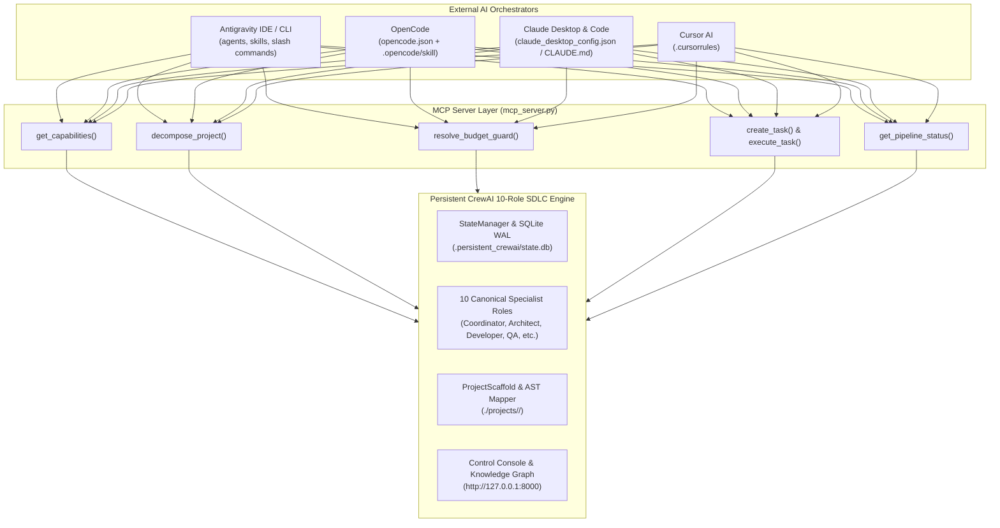

# Delivery Report: Cross-Platform Orchestrator Alignment & Production Hardening

This deliverable confirms the completion and end-to-end verification of all critical alignment items from [`crewai-handoff.md`](file:///c:/Users/User/Downloads/crewai-handoff.md) for the **Persistent CrewAI 10-Role Multi-Agent SDLC Framework**. The codebase is now production-ready, fully compatible with **Antigravity**, **OpenCode**, **Claude (Desktop & Code)**, and **Cursor**, and cleanly pushed to [`origin/main`](https://github.com/david1998creator/Full-Stack-Development.git).

---

## 1. Executive Summary of Implementations

| Area | Status | Deliverables & Implementation Details |
| :--- | :---: | :--- |
| **Role Taxonomy Unification** | **VERIFIED** | Canonicalized all 10 roles across [`config.py`](file:///C:/Users/User/.gemini/antigravity/scratch/persistent_crewai_team/src/persistent_crewai/config.py), [`AGENTS.md`](file:///C:/Users/User/.gemini/antigravity/scratch/persistent_crewai_team/AGENTS.md), [`CLAUDE.md`](file:///C:/Users/User/.gemini/antigravity/scratch/persistent_crewai_team/CLAUDE.md), [`.cursorrules`](file:///C:/Users/User/.gemini/antigravity/scratch/persistent_crewai_team/.cursorrules), [`README.md`](file:///C:/Users/User/.gemini/antigravity/scratch/persistent_crewai_team/README.md), and all skill directories. |
| **Role Alias Normalization** | **VERIFIED** | Expanded `ROLE_ALIASES` in `config.py` to seamlessly normalize `qa`, `sdet`, `devops`, `infra`, `db engineer`, `coder`, `programmer`, `secops`, `git`, etc. |
| **README & Quickstart Accuracy** | **VERIFIED** | Updated clone command to target `Full-Stack-Development`. Clarified Section 8 offline mechanics (`--mock` / `MOCK_LLM=1` vs live runtime keys). |
| **MCP Server Enhancements** | **VERIFIED** | Enhanced [`src/persistent_crewai/mcp_server.py`](file:///C:/Users/User/.gemini/antigravity/scratch/persistent_crewai_team/src/persistent_crewai/mcp_server.py) with `get_capabilities`, `decompose_project`, `resolve_budget_guard`, `create_task`, `execute_task`, and physical file scaffolding. |
| **SQLite Schema & StateManager** | **VERIFIED** | Fixed `workflow_runs` trigger constraint (`'api'`), added `ensure_directories()` to `ProjectScaffold`, and added `complete_task` alias on `StateManager`. |
| **OpenCode Integration** | **VERIFIED** | Created root [`opencode.json`](file:///C:/Users/User/.gemini/antigravity/scratch/persistent_crewai_team/opencode.json) and mirrored [`.opencode/skill/crewai-orchestrator/SKILL.md`](file:///C:/Users/User/.gemini/antigravity/scratch/persistent_crewai_team/.opencode/skill/crewai-orchestrator/SKILL.md). |
| **Claude & Cursor Configurations** | **VERIFIED** | Configured [`mcp.json`](file:///C:/Users/User/.gemini/antigravity/scratch/persistent_crewai_team/mcp.json) and [`claude_desktop_config.json`](file:///C:/Users/User/.gemini/antigravity/scratch/persistent_crewai_team/claude_desktop_config.json) to use platform-agnostic root launcher `python mcp_server.py`. |
| **Automated CI Matrix** | **VERIFIED** | Authored [`.github/workflows/tests.yml`](file:///C:/Users/User/.gemini/antigravity/scratch/persistent_crewai_team/.github/workflows/tests.yml) running automated test suites on Python 3.11, 3.12, 3.13 across Ubuntu and Windows. |
| **Unit & E2E Verification** | **VERIFIED** | Created [`tests/test_mcp_server.py`](file:///C:/Users/User/.gemini/antigravity/scratch/persistent_crewai_team/tests/test_mcp_server.py) (4/4 tests passing). Playwright headless E2E passed 100% with zero console errors. |

---

## 2. Platform Interoperability Matrix

---

## 3. Verification Highlights

### A. MCP Server Tool Suite Verification
The test suite in [`tests/test_mcp_server.py`](file:///C:/Users/User/.gemini/antigravity/scratch/persistent_crewai_team/tests/test_mcp_server.py) verifies:
1. `get_capabilities`: Confirms active mode, configured API keys, workspace roots, and exact 10 canonical roles.
2. `decompose_project`: Persists 5 discrete engineering tasks in SQLite and triggers `PAUSED_FOR_HUMAN` token budget estimation.
3. `resolve_budget_guard`: Approves the budget and immediately transitions tasks to `ready_tasks`.
4. `create_task` & `execute_task`: Normalizes aliases (e.g. `'coder'` $\rightarrow$ `'Developer'`), runs subtask execution, records completion in SQLite WAL, and scaffolds physical files (`index.html`).
5. `get_pipeline_status`: Verifies task counts, active agents, and status.

### B. Playwright In-Browser E2E
Running `python tests/e2e/test_milestones_and_hitl.py` verified:
- **Upfront Reassurance Status Banner**: Visible on load.
- **5-Phase Milestones Roadmap**: Loaded and visually confirmed.
- **In-Browser Cytoscape Knowledge Graph**: Rendered 27 nodes and 26 edges.
- **Human-in-the-Loop Notification Drawer**: Verified `PAUSED_FOR_HUMAN` budget approval card and 0 pending badge post-approval.
- **Browser Console Errors**: 0 console errors detected.

---

## 4. Git Revision Details
- **Branch**: `main`
- **Commit**: `93b6210`
- **Commit Message**: `feat(mcp): align multi-agent orchestrator across Antigravity, OpenCode, Claude, and Cursor`
- **Remote**: Successfully pushed to `origin/main` (`https://github.com/david1998creator/Full-Stack-Development.git`).
